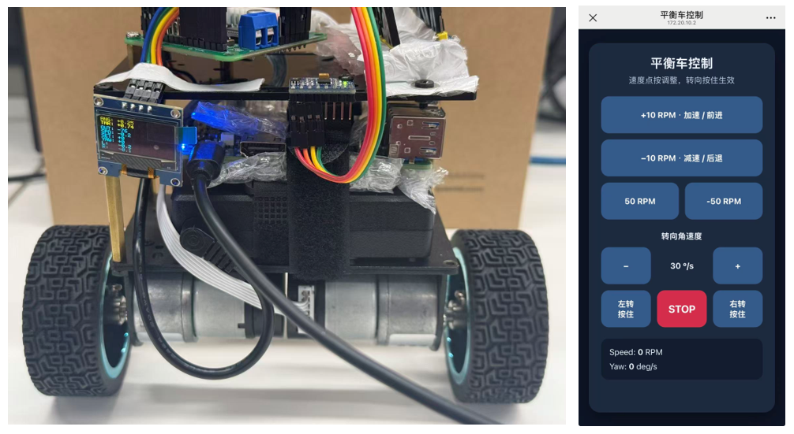

# Two-Wheel Self-Balancing Car

A two-wheel self-balancing car demo built with **Quectel Pi M2 and STM32**.

STM32 handles attitude sensing, motor drive, and balance control. Quectel Pi M2 provides Web control and UART communication. With a phone connected to the same Wi-Fi network as the M2, you can open the control page in a browser to drive the car forward, backward, and around turns.


## Features

- MPU6050 attitude sensing and angle fusion
- Two-wheel self-balancing control
- Motor speed measurement using encoders
- PID upright loop, speed loop, and turning loop
- UART communication between M2 and STM32
- Remote control through a Web page
- Forward, reverse, stop, left turn, and right turn

## Hardware

| Hardware | Description |
| --- | --- |
| Quectel Pi M2 | Web control and UART communication |
| STM32F103C8T6 | Real-time car control |
| MPU6050 | Six-axis IMU for acceleration and angular-velocity measurements |
| Geared motors with encoders | Drive and speed feedback |
| TB6612 | Dual DC motor driver |
| OLED | Status display |

## Project Structure

```text
demo-balance-car/
├── balance_car_m2/                    # Quectel Pi M2 application
│   ├── include/
│   │   ├── car_control.h              # Motion targets and control interface
│   │   └── uart.h                     # Serial communication and motion command interface
│   ├── src/
│   │   ├── car_web.c                  # Embedded Web page, HTTP API, and server entry point
│   │   ├── car_control.c              # Speed, turning, and stop command handling
│   │   └── uart.c                     # Linux serial configuration and control frame transmission
│   └── Makefile                       # M2 build rules
├── balance_car_stm32/                 # STM32 real-time control firmware
│   ├── Core/
│   │   ├── Inc/                      # Control module and peripheral interface headers
│   │   └── Src/
│   │       ├── main.c                # Peripheral initialization and main loop
│   │       ├── balance_car.c         # Control task, timer interrupt, and safe shutdown
│   │       ├── balance_controller.c  # Upright balance control
│   │       ├── speed_controller.c    # Encoder-based speed PI control
│   │       ├── turn_controller.c     # Yaw-rate turning control
│   │       ├── attitude.c            # Gyroscope calibration and attitude angle fusion
│   │       ├── mpu6050.c             # MPU6050 initialization and data acquisition
│   │       ├── motor.c               # Dual-motor direction, PWM, and stop control
│   │       ├── encoder.c             # Wheel encoder counts and speed calculation
│   │       ├── pid.c                 # General PID calculation and output limiting
│   │       ├── key.c                 # Balance switch state detection
│   │       ├── oled.c                # OLED status display
│   │       ├── system_init.c         # System clock and error handling
│   │       └── usart.c               # USART1 initialization and control frame parsing
│   ├── Drivers/                       # STM32 HAL and CMSIS
│   ├── MDK-ARM/                       # Keil project and startup assembly source
│   ├── balance_car_stm32.ioc          # STM32CubeMX configuration
│   └── .mxproject                     # STM32CubeMX generation records
│
├── .gitignore
├── README.md                         # English README
└── README_zh.md                      # Chinese README
```

## Quick Start

### STM32

Open the following project in Keil MDK:

```text
balance_car_stm32/MDK-ARM/balance_car_stm32.uvprojx
```
After building, flash the firmware to the STM32 using ST-Link.
### Quectel Pi M2
On the M2, enter the balance_car_m2 directory, then build and run the application:
```
make car_web
./car_web
```
The application listens on 0.0.0.0:8080 by default. Connect your phone and the M2 to the same Wi-Fi network, then open the following address in a browser:
http://<M2_IP>:8080

This opens the car's Web control page.

## Web Control

The Web page sends control commands to the M2 over HTTP. The M2 then sends the target speed and target yaw rate to the STM32 over UART.
Speed is adjusted with taps, while turning is active while a turn button is held. Releasing the button resets the target yaw rate to `0 °/s`.

## Control Parameters

The main control parameters are located in the STM32 project:

| Parameter | Purpose |
| --- | --- |
| `BALANCE_CAR_BALANCE_ANGLE_DEG` | Mechanical balance angle |
| `BalancePID.config.kp/kd` | Upright loop gains |
| `SpeedPID.config.kp/ki` | Speed loop gains |
| `TurnKp` | Turning loop gain |
| `target_speed_rpm` | Target speed |
| `target_yaw_rate_dps` | Target yaw rate |

Tune the parameters in this order: **upright loop → speed loop → turning loop**.

## Notes

- Confirm the MPU6050 mounting orientation before tuning.
- For the first test, keep the wheels off the ground to verify the motor directions.
- Adjust PID parameters gradually; avoid large changes in a single step.
- Keep the phone and M2 on a stable Wi-Fi connection. Poor network quality may delay Web controls.
- After changing the STM32 firmware, rebuild it and flash it again using ST-Link.

## Report an Issue
If you encounter any problems, please post a technical support request on the official Quectel forum. Our support team will be happy to help. Issues and Pull Requests to improve this project are also welcome.
